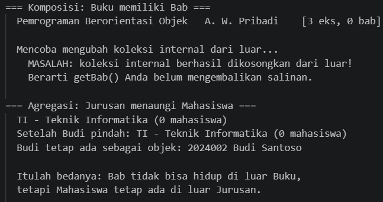
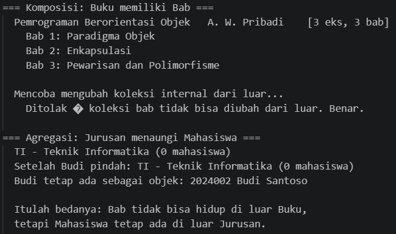
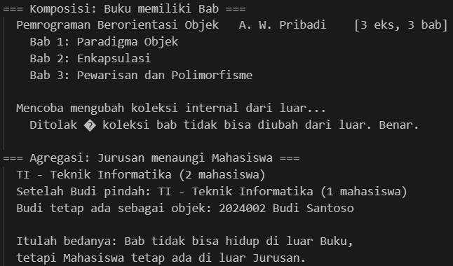
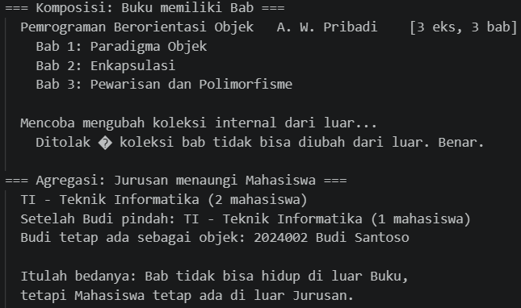
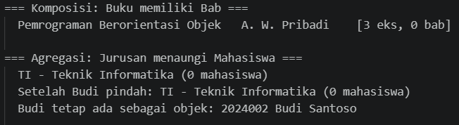
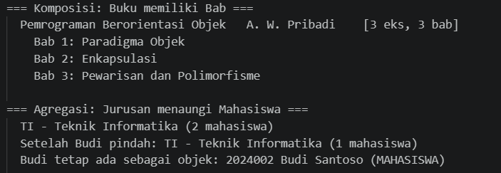
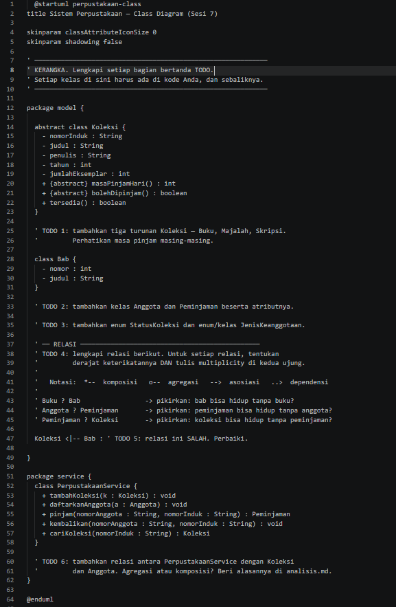
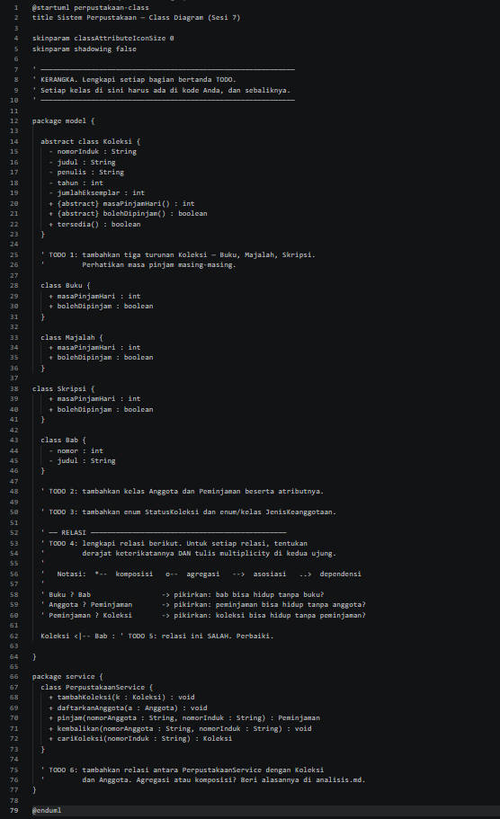

# LAPORAN PRAKTIKUM PEMROGRAMAN BERBASIS OBJEK

| Informasi Praktikan | Keterangan |
| :--- | :--- |
| **Nama** | I Gede Ardhika Arimbawa tangkas |
| **NPM** | 4525210080 |
| **Kelas** | A |
| **Mata Kuliah** | Pemrograman Berbasis Objek (PBO) |
| **Pertemuan** | 7 - UML |
| **Tanggal** | 15 Oktober 2026 |

---

# 1. Implementasi Materi

## 1.1 Java

### 1.1.1 Buku.java
**Penjelasan Kode:**
> [File java ini berisi dengan perilaku dan persyaratan yang akan dipanggil oleh PerpustakaanService.java]

**Sebelum:**
> [arahan: menolak jumlah eksemplar negatif, mengembalikan salinan yang tidak bisa diubah, mengurangi stok; tolak bila sudah nol.]

**Hasil Run Codingannya Sebelum:**

**Sesudah:**
> [jumlah eksemplar negatif ditolak, salinan yang tidak bisa diubah dikembalikan, stok dikurangi dan ditolak jika sudah nol.]

**Hasil Run Codingannya Sesudah:**

### 1.1.2 Jurusan.java
**Penjelasan Kode:**
> [File java ini berisi dengan perilaku dan persyaratan yang akan dipanggil oleh PerpustakaanService.java]

**Sebelum:**
> [arahan: menerima objek Mahasiswa dari luar, melepaskan dari jurusan, mengembalikan salinan tak-berubah.]

**Hasil Run Codingannya Sebelum:**

**Sesudah:**
> [objek Mahasiswa dari luar diterima, jurusan dilepaskan, salinan tab-berubah dikembalikan.]

**Hasil Run Codingannya Sesudah:**

### 1.1.3 PerpustakaanService.java
**Penjelasan Kode:**
> [File java ini akan memanggil model dari Buku.java dan Jurusan.java]

**Sebelum:**
> [arahan: menentukan cara layanan ini menyimpan koleksi dan anggota.]

**Hasil Run Codingannya Sebelum:**

**Sesudah:**
> [layanan ini menyimpan koleksi dan anggota.]

**Hasil Run Codingannya Sesudah:**

## 1.2 PHP

### 1.2.1 relasi.php
**Penjelasan Kode:**
> [File java ini berisi dengan perilaku dan persyaratan yang akan dipanggil oleh main.php]

**Sebelum:**
> [arahan: membuat constructor readonly, menolak jumlah eksemplar negatif, melengkapi fungsi tambahbab, menerima objek dari luar, melepaskan dari jurusan.]

**Hasil Run Codingannya Sebelum:**

**Sesudah:**
> [constructor readonly telah dibuat, jumlah eksemplar negatif ditolak, fungsi tambahbab telah dilengkapi, objek dari luar diterima, terlepas dari jurusan.]

**Hasil Run Codingannya Sesudah:**

## 1.3 UML

### 1.3.1 perpustakaan-kerangka.puml
**Penjelasan Kode:**
> [File java ini berisi dengan kerangka konsep bentuk file java dan php yang telah dibuat.]

**Sebelum:**
> [arahan: menambahkan tiga turunan Koleksi, menambahkan kelas Anggota dan Peminjaman beserta atributnya, menambahkan enum StatusKoleksi dan enum/kelas JenisKeanggotaan, melengkapi relasi, menambahkan relasi antara PerpustakaanService dengan Koleksi.]

**Hasil Run Codingannya Sebelum:**

**Sesudah:**
> [Tiga turunan Koleksi ditambahkan, kelas Anggota dan Peminjaman beserta atributnya ditambahkan, enum StatusKoleksi dan enum/kelas JenisKeanggotaan ditambahkan, relasi sudah lengkap, relasi antara PerpustakaanService dengan Koleksi ditambahkan.]

**Hasil Run Codingannya Sesudah:**
